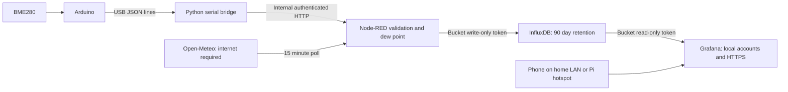

# EdgeClimate: Secure Offline Environmental Monitoring with Cloud Weather Context

An edge-computing project using an existing Arduino/BME280 and Raspberry Pi.
The Pi measures indoor conditions over USB, stores them locally, and compares
them with outdoor weather **model estimates**. Local multi-user access works
without internet. Cloud weather is supplementary and explicitly becomes stale.

## Hardware, software and keys

Use the equipment you already have: Arduino, connected BME280, existing USB
cable, Pi, power supply/storage, and phone. Leave your existing heating system
independent of this project. A single BME280 measures one physical location; Open-Meteo is not
a second physical sensor at your house.

Use 64-bit Raspberry Pi OS, Docker with Compose v2, Python 3 and OpenSSL.
Check storage (`df -h`), Docker (`docker info`) and the OS (`uname -m`) before
pulling images. InfluxDB requires a compatible 64-bit platform. Image tags
are explicit except InfluxDB's 2.7 release line; review security updates and
capture image digests in experiment evidence. First installation needs internet;
after pulling images, local ingestion/storage/dashboard need no cloud service.

**API key: none for the Open-Meteo public non-commercial endpoint.** The free
endpoint is rate limited and has no availability guarantee. This flow requests
once every 15 minutes (about 96/day). Confirm current terms before submission or
commercial deployment: <https://open-meteo.com/en/terms> and
<https://open-meteo.com/en/licence>. Attribute Open-Meteo and CC BY 4.0 in reports
and dashboards. Commercial customer access may require a paid endpoint/key;
that is not configured by this project. Tavily is not used.

The init command generates local passwords, service tokens and a local TLS CA.
They are credentials for **your Pi**, not paid external API keys. Values stay in
ignored `.edge/` files. Never paste them into chat or commit them to Git.

## Architecture



Node-RED uses built-in HTTP nodes; no community-node downloads are needed at
startup. The Python bridge uses the standard library, including Linux termios.
Grafana has a provisioned dashboard and datasource, so it needs no external
plugins. The only supported stack is `compose.edge.yml`, project `edgeclimate`,
using named volumes for persistence. The repository uses one branch, `main`.
The former Zigbee/Hive Compose definition and seed configuration have been
removed from current source; they remain recoverable through Git history.
Existing runtime directories and containers are not removed by that source
cleanup. Inspect and stop unused older containers individually; never delete
their data to make room without a verified backup.

## Install on your Pi

From this checkout, after bringing these source files onto the Pi:

```sh
cd ~/cloud2edge-hive
chmod +x scripts/edge
./scripts/edge init
ls -l /dev/serial/by-id/
nano .edge/config.env
```

Set `ARDUINO_DEVICE` to the full Arduino `/dev/serial/by-id/...` path, without
the `-> ../../tty...` part. Set
`SERIAL_BAUD` to the existing sketch's baud rate, initially 9600 in the example.
The script reads the device group automatically. Close Serial Monitor and any
other program reading that serial port before starting.

Expected input is one JSON object per line, numbers in °C, %, and **hPa**:

```json
{"temperature":21.6,"humidity":48.2,"pressure":1013.4}
```

Your IDE screenshot shows **Arduino UNO selected**. Select its serial port under
Tools → Port, open Serial Monitor (Ctrl+Shift+M), and check its baud setting and
actual output. The screenshot's open sketch is an empty template: don't upload
that over working firmware. Your working sketch is authoritative: send its
output before changing firmware.
`edge/arduino/bme280_json/bme280_json.ino` is an optional
reference, not a hardware-tested replacement for your board. It requires Adafruit BME280
and Unified Sensor libraries. Keep your current wiring and check voltage limits.

Weather defaults to approximate Wolverhampton town-centre coordinates:

```dotenv
WEATHER_ENABLED=true
WEATHER_LATITUDE=52.587
WEATHER_LONGITUDE=-2.129
WEATHER_LOCATION=wolverhampton
```

These are town-level coordinates, not your home address. Coordinates are sent
to Open-Meteo. Set `WEATHER_ENABLED=false` for a deliberately local-only test.
Re-running init preserves an existing config: update its weather settings
manually if it was created before Wolverhampton became the default.

For access from a phone, identify the Pi address with `hostname -I`. Issue a
certificate for the address you will actually use, for example:

```sh
./scripts/edge cert 192.168.1.50
```

Replace that example IP. Set `EDGE_BIND` in `.edge/config.env` to that same Pi
LAN or hotspot IP (default `127.0.0.1` allows the Pi only). Install/trust the
**public** `.edge/tls/ca.crt` on the phone/browser using its certificate settings.
Never copy `ca.key`, server private keys, or the secrets directory to the phone.
Do not bypass TLS warnings. Reissue for a changed IP and restart Grafana. The
local certificate lasts one year; retain the CA securely and renew the server
certificate before expiry.

```sh
./scripts/edge up
./scripts/edge status
./scripts/edge verify
```

Grafana is `https://<actual-pi-ip>:3443` (on the Pi with default settings,
`https://localhost:3443`). Type the real address; angle-bracket examples are
placeholders. Users: `admin`, `researcher` (Editor), `viewer` (Viewer). Read
their initial passwords **locally** from `.edge/secrets/grafana_admin_password`,
`researcher_password` and `viewer_password`. No secrets are printed by scripts.
Use separate real user accounts for additional people, not shared project
accounts. The generated demonstration accounts illustrate roles. Disable them
when no longer needed. Existing accounts/role changes are preserved on restart.

The main dashboard is provisioned and intentionally immutable. Editors can
save a copy or create a new dashboard. The automated permission test creates
and removes a temporary dashboard with the researcher account.

Node-RED's editor is localhost-only at `http://localhost:1880`, account `admin`,
password in `.edge/secrets/nodered_admin_password`. For administration from
another computer use SSH encryption, for example:

```sh
ssh -N -L 1880:127.0.0.1:1880 your-pi-user@your-pi-address
```

Then use that computer's `http://localhost:1880`. Don't expose port 1880 on the
LAN or internet. Editor flow files are source-controlled read-only mounts:
edit `edge/nodered/flows.json` in the repository and restart Node-RED. The editor
is for inspecting/debugging; persist reviewed flow changes through Git.

`./scripts/edge logs` shows bounded operational logs; `down` stops only this
stack and preserves its volumes. No command here pushes Git changes.

## Software-only test before hardware

```sh
./scripts/edge init
./scripts/edge demo
./scripts/edge verify
node --test edge/tests/logic.test.js
python3 -m unittest discover -s edge/tests -p 'test_*.py'
```

Demo mode stops this project's serial bridge and starts the simulator. Up mode
does the reverse. Simulation appears only in a clearly labelled panel and is
excluded from the physical indoor panels. The acceptance check writes a
simulated `acceptance-test` measurement; it never claims actual BME280 input.
Stop simulation and run `up` before collecting physical demonstration evidence.

## Security and governance scope

| Identity | Permission |
|---|---|
| Grafana admin | Manage local users and configuration |
| Grafana researcher / Editor | Query shared project data; create/edit own dashboards |
| Grafana Viewer | Query/view shared data, no dashboard editing |
| Node-RED service | Write only the environment bucket |
| Grafana service | Read only the environment bucket |
| Serial bridge | Submit validated measurements, no database credentials |

Grafana OSS roles are **not per-sensor or per-tenant isolation**. Users within
this organisation can query the shared datasource. Viewers can access data
beyond a particular dashboard's selected fields. Separate tenant datasets need
an enforced isolation design, not just dashboard filters. OS/Docker admins are
trusted and can read local credentials; restrict SSH and Docker access.

InfluxDB is not published to the host network. The backend network is internal;
Node-RED alone also has an egress network for HTTPS weather requests. Local
backend traffic uses an isolated Docker network, not TLS between every service.
Grafana is HTTPS, with anonymous access, public sign-up and organisation
creation disabled. The Node-RED editor requires a password and is localhost
only. Generated passwords use cryptographic randomness; Node-RED's custom
authentication stores an scrypt hash and logs audit events. Ingest uses an
independent bearer token on the internal network.

Retention is 90 days for the environment bucket. Tags are `source`, `sensor_id`,
and `location`. Fields include temperature (°C), humidity (%), pressure (hPa),
derived indoor dew point and `ingested_at` (Unix seconds). Indoor `_time` is Pi
receipt time, not a verified Arduino clock; weather `_time` is model valid time.
Repeated weather fetches overwrite the same point without making its valid
time fresh. Invalid values/units/timestamps are rejected. API failure is
isolated from indoor collection. No stale-value imputation is performed.

Influx writes are acknowledged before returning success to the bridge. This
starter does not have a durable serial queue: database/Node-RED failure can lose
readings and is logged; router failure alone should not interrupt the local
path. Don't claim zero-loss ingestion, exactly-once delivery, a complete audit
trail, or certified compliance. Add a durable outbox if those become requirements.
Secure the Pi clock before testing; it can drift across power loss without NTP
or an RTC. Keep it powered through the router-off experiment.

Governance evidence: document user creation, role changes and revocation with
timestamps/screenshots, redacting credentials. Grafana server logs and Node-RED
audit events aid diagnosis but are not an immutable or exhaustive per-user data
access audit. Record retention decisions, source attribution, location
disclosure and intended users in your report. Use privacy-conscious labels.

Rotation: use Grafana UI for user passwords and disable/revoke accounts. For
service-token rotation, an administrator creates a replacement bucket-scoped
Influx token, writes its value privately into the matching `.edge/secrets/`
file, restarts its consumer (`nodered` or `grafana`), checks access, and revokes
the old token. Do not delete token files and assume no previous token remains.
Changing stored initial Grafana password files does not change existing users'
passwords. Node-RED passwords/hashes likewise must be updated together.

## Router-off demonstration and mobile access

First distinguish internet loss from router power-off: internet loss preserves
home Wi-Fi; powering off the router removes it. USB sensing and Pi-local storage
work in both cases. A phone needs an independent link to the Pi for the second.

No additional device should be needed if your Pi's Wi-Fi supports access-point
mode. Check **on the Pi** before changing networking:

```sh
nmcli general status
nmcli device status
iw list
```

Look for `AP` under supported interface modes and confirm NetworkManager owns
the wireless interface. A possible arrangement is Ethernet to your router and
the Pi's built-in Wi-Fi dedicated to its hotspot. A single Wi-Fi interface may
not reliably act as both an upstream client and access point. If the Pi is
currently accessed over Wi-Fi, switching it can disconnect you: configure from
its local keyboard/display. The setup scripts intentionally don't change active
networking. Share the Pi model and these command results before choosing exact
hotspot commands. Older OS/network managers need different steps.

After a password-protected hotspot is configured, issue a dashboard certificate
for the hotspot address, bind Grafana there, and connect your phone to it. Some
phones abandon Wi-Fi with no internet: select stay connected and disable mobile
data for the experiment. A Pi-local display is sufficient to prove offline
ingestion even before mobile hotspot validation.

Experiment:

1. Start hardware mode; verify new BME280 readings and weather estimates.
2. Capture the last weather valid time and an indoor timestamp; ensure clock is
   correct. Connect phone to the Pi hotspot; disable mobile data.
3. Power off only the router, keeping Pi and Arduino powered.
4. Gently warm the BME280 without touching exposed circuitry. Allow for sensor
   sampling interval. Capture new indoor readings, timestamps and graphs.
5. Weather age increases and eventually turns red (default 30 minutes), or
   shows no data if never fetched. Indoor age threshold is 60 seconds: adjust
   that panel if your sampling interval is longer. Do not claim stale weather
   is live data. Evidence can include logs of failed weather polls.
6. Demonstrate Viewer editing denied, Editor editing permitted and local logins
   continuing. Re-enable the router and observe weather recover.

## Scalability and evaluation

Multiple sensor IDs and multiple local users are supported by the schema and
roles. This is a single Pi, not a distributed/high-availability platform. Record
hardware model, RAM, storage, sampling rate, concurrent users, software/image
versions, CPU/memory (`docker stats --no-stream`), request failure rate and
response latency during a controlled workload. Label synthetic workloads.
`./scripts/edge benchmark` runs 100 synthetic ingestion requests from four
concurrent clients using 10 simulated sensor IDs and reports acknowledgements,
errors, throughput, p50 and p95 response latency. These are ingestion request
measurements, not distinct stored-point counts or dashboard-user concurrency.
Increase load gradually; quantify observed capacity rather than claiming
unmeasured horizontal scalability. Grafana Viewer versus Editor is a permission
test, not by itself a scale test. A capacity study with gradually increasing
workloads and concurrent dashboard users remains future work.

## Backups and recovery

```sh
./scripts/edge backup
```

This stops **only** this project and creates a private cold archive in
`.edge/backups/` containing all three named-volume datasets, settings, tokens
and certificates. It checks archive structure, not a full restoration. Restart
with `up` or `demo`. Store encrypted copies off the Pi under restricted access.
Backups can outlive the 90-day database retention: give backups an explicit
expiry policy too.

Before relying on recovery, rehearse restoration in an isolated project with
fresh volumes: extract the archive into a private directory; restore the three
`volumes/` trees into the matching stopped volumes and `private/` into `.edge/`;
retain compatible image versions/ownership; then run verification and inspect
historical readings. Never extract an archive over a running or valuable
database. This project deliberately has no automatic destructive restore.

## Validation status

Run `./scripts/edge verify` for functional ingestion, scoped-token denial,
anonymous denial, Viewer/Editor permissions, TLS verification and Grafana's real
datasource query. `node --test edge/tests/logic.test.js` checks unit/range errors,
tag-injection rejection, synthetic-source separation and weather valid-time
semantics. An Arduino firmware build, USB hardware validation, live API access,
hotspot, physical router-off experiment, load benchmark and restore rehearsal
need separate evidence; do not treat a software simulation as any of those.

In managed cloud environments the Open-Meteo domain may require adding
`api.open-meteo.com` to environment settings. API availability in that machine
does not establish availability on your Pi, and vice versa.
